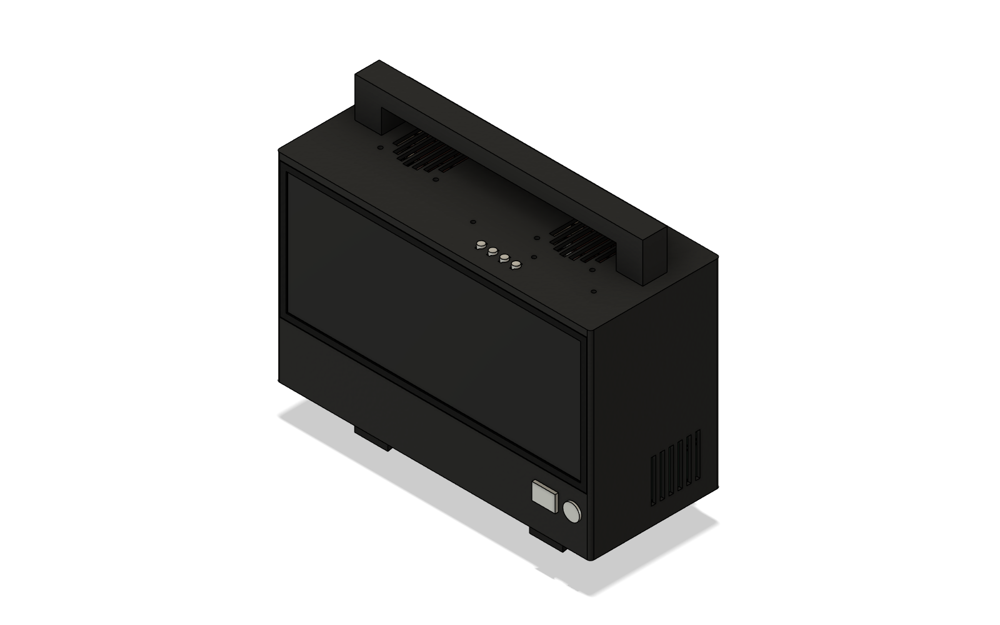
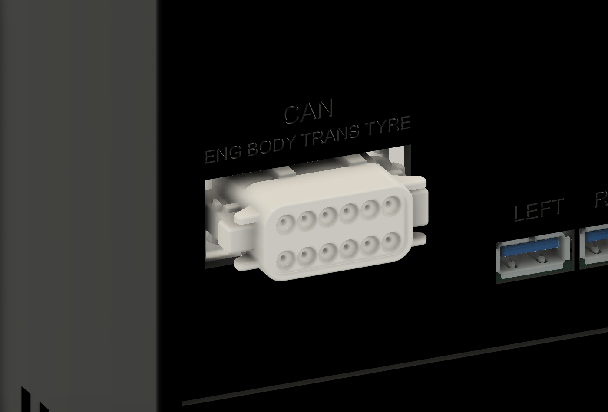
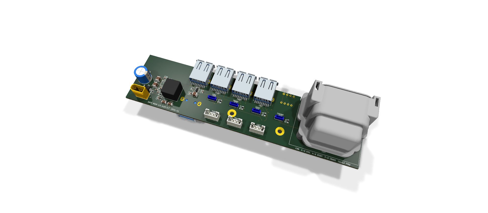

# Dash Bench Box

A portable, battery-powered workstation built around an **ODROID-H5** and a **10.25" bar screen** in a 3D-printed
case with a carry handle, with **four isolated CAN bus ports on one connector** and **four USB camera ports wired
straight to the computer**. Think of it as a chunky, repairable laptop for developing a car's dash and camera
computer on the bench, before any of it goes in a car.



It is the sister of the [Bench Box V2](https://github.com/LionheadGuy/bench-box-v2): the same computer, battery,
charger, converter, fans, handle and feet, in a wider, lower case. What it adds is the CAN and camera side; what it
leaves out is WiFi, LTE, Bluetooth, the USB hub and the Stream Deck dock, none of which a dash computer needs.

| | |
|---|---|
| Computer | ODROID-H5 (Intel Core i3-N300, 8 cores), 16 GB DDR5, NVMe SSD |
| Screen | 10.25" 1920 x 720 IPS bar screen, flush in the front frame (no touch) |
| CAN | 4 isolated channels (PEAK PCAN-M.2 Four Channel), all on **one 12-way sealed connector** in the back wall, with a 120 Ω terminator switch per bus |
| Cameras | 4 USB-A ports on the back, each wired to its **own** port on the computer - never through a hub |
| Timing and clock | its own GPS receiver (u-blox NEO-M9N, up to 25 fixes a second) with an SMA antenna jack in the back wall |
| Battery | 14.8 V 6.6 Ah LiPo (~98 Wh) with a smart BMS; ~3 h at a typical 30 W |
| Charging | USB-C PD (60 W+ charger; 100 W for the fastest charge), runs while charging, no break when unplugged |
| Network | Ethernet on a keystone jack in the back wall |
| Cooling | 3 Noctua fans (one in, two out), on the H5's own fan control |
| Size | about 284 x 180 x 117 mm (W x H x D) + 36 mm handle |
| Weight | about 2.7 kg (estimate) |

> ## Status: read this first
>
> **The design is not finished and nothing has been built.** The case, the rear I/O board and the breakout cable are
> designed and checked in CAD and KiCad, but no part has been printed, no board has been made, and the screen has not
> been bought: **every dimension that comes from the screen is taken off a seller's listing photo, not measured.**
> Treat this repository as a design to read and adapt, not a kit to build today. It will be updated as the first box
> is built.
>
> Specifically still open: the screen's real size and how it is powered, the pictures of the box's back (the render
> here shows an older revision of the rear ports), the wire-by-wire diagrams, and the GPS receiver's place inside the
> case.
>
> **Lithium safety**: the pack is a large LiPo with no protection of its own. Never connect it without the BMS, keep
> it in a fireproof LiPo sleeve, charge it where you can watch it until you trust the build, and test new boards on a
> current-limited bench supply first.

## Pictures (CAD)

| The CAN port | The rear I/O board |
|---|---|
|  |  |

## What's here

| Folder | What |
|---|---|
| [`print/`](print) | **Slicer-ready `.3mf` files**, one per print job, parts already laid flat |
| [`stl/`](stl) | the same parts as STL, in their assembled positions (GitHub shows them in 3D) |
| [`cable/`](cable) | the CAN breakout cable: parts, pinout, lengths, build |
| [`bom.csv`](bom.csv) | the parts list below as a spreadsheet |
| [`images/`](images) | the pictures on this page |

## How the CAN side works

The computer listens to four separate vehicle buses at once. Each channel of the PEAK card is electrically isolated
from the others, so **each bus keeps its own ground** all the way to the connector: 4 x (CAN High, CAN Low, that
bus's ground) = 12 wires.

Rather than four chassis connectors, all twelve land in **one sealed DEUTSCH DTM 12-way connector** in the back wall:

| Cavities | Bus | Typical speed |
|---|---|---|
| 1, 2, 3 | ENGINE (H, L, GND) | 1 Mbit/s |
| 4, 5, 6 | BODY | 500 kbit/s |
| 7, 8, 9 | TRANSMISSION | 1 Mbit/s |
| 10, 11, 12 | TYRE / TPMS | 1 Mbit/s |

A **breakout cable** plugs in there and fans out into four legs, one per bus, each ending in three bootlace ferrules
that screw into a cheap single-channel USB-CAN adapter. So on the bench one laptop with four ~$45 adapters can play
recorded or simulated traffic into all four buses at once; in a car the same plug takes one twelve-wire branch of the
harness. The cable is in [`cable/`](cable): parts, pinout, lengths and how to build it.

**Termination**: a 4-way DIP switch on the rear I/O board puts a 120 Ω resistor across H and L of each bus, one lever
per bus. Turn a lever on when the box is a physical **end** of that bus (which, on a short bench bus of two devices,
it usually is) and off when it is a tap in the middle of a longer one.

## Bill of materials

**Roughly $1,500 for the bought parts** of the core build (estimate; without the screen's price, which varies, and
without the custom boards, whose price is to be announced). The PEAK CAN card is about a third of that on its own -
see the note under it for the cheap way to start. Prices are approximate (USD) and change; links are to the maker or
a major seller. "x2" etc. is how many the box uses.

### Computer

| Part | Qty | For | Price | Notes |
|---|---|---|---|---|
| [Hardkernel ODROID-H5](https://www.hardkernel.com/shop/odroid-h5/) | 1 | the computer | $230 | no power adapter needed; ships from Korea |
| [16 GB DDR5 SODIMM (Corsair CMSX16GX5M1A5600C48)](https://www.amazon.com/dp/B0CV1DDFHC) | 1 | RAM | $249.99 | any single DDR5 SODIMM works; runs at 4800 |
| [M.2 2280 NVMe SSD (SanDisk Optimus 5100 500 GB)](https://www.amazon.com/dp/B0GJSFFLXZ) | 1 | storage, slot M2_SSD1 | $108.89 | any M.2 2280 NVMe. Camera recordings fill a disk fast: a 1 TB or 2 TB drive is worth it |
| [PEAK PCAN-M.2 Four Channel (IPEH-004085)](https://www.peak-system.com/PCAN-M-2.473.0.html) | 1 | the four CAN buses, slot M2_SSD4 | ~$495 | M.2 2280 PCIe card, **each channel isolated**, -40 to +85 °C. The opto-decoupled four-channel version is the one this box is wired for. Linux drivers are in the kernel (`peak_pciefd`) |
| [Single-channel USB-CAN adapter (DSD TECH SH-C30G)](https://www.amazon.com/s?k=DSD+TECH+SH-C30G) | 0-4 | **the cheap way in**: feeding or reading one bus from a laptop | ~$44 each | isolated, built-in 120 Ω switch, open-source candleLight firmware (`gs_usb`/SocketCAN, no driver on Linux). Four of them plug into the breakout cable's four legs. Buy **one** first and prove your tooling with it |

**A note on cost:** the PEAK card is what makes this box listen to four live buses at full rate at once. If you only
need one or two buses, or only to play back recorded traffic, leave the card out and start with the USB adapters -
the case, the ports and the rest of the build do not change, and the card drops in later.

### Screen and controls

| Part | Qty | For | Price | Notes |
|---|---|---|---|---|
| [ROADOM 10.25" 1920 x 720 IPS bar screen](https://www.amazon.com/s?k=ROADOM+10.25+inch+1920x720+bar+screen) | 1 | main screen | ~$100-150 | **the frame is sized from the listing's photos, not from a measured screen**: about 276.9 x 121.9 x 22.9 mm, 75 mm VESA (M4), buttons and ports on a raised block on the back. Measure yours and change the parameters before printing the shell |
| [12 mm momentary metal push button, 5 V ring LED](https://www.amazon.com/s?k=12mm+momentary+metal+push+button+5V+ring+LED) | 1 | power button | ~$5-8 | 11.75 mm hole; NO contacts + LED |
| [KCD1 rocker switch, 20 A (Dopkiut, 10-pack)](https://www.amazon.com/dp/B0HCZ5X637) | 1 | master power switch | $6 | 19.2 x 12.7 mm cut-out |

### Battery and charging

The same power system as the Bench Box V2, part for part.

| Part | Qty | For | Price | Notes |
|---|---|---|---|---|
| [Liperior Endurance 6600 mAh 4S2P LiPo (LPD66004S150)](https://rcbattery.com/liperior-endurance-6600mah-4s2p-150c-14-8v-speed-runs-lipo-battery.html) | 1 | the pack, ~98 Wh | $69.99 | 135 x 54 x 42 mm, bare 7 AWG leads, no protection of its own |
| [JBD SP04S010A smart BMS, 4S, NMC / Li-ion version, 20 A or 30 A](https://jbdbms.com/products/sp04s010a) | 1 | protection and balancing | ~$17.50 | pick the NMC (Li-ion) 4S version |
| [LiPo safety bag (DerBlue, 185 x 75 x 60 mm)](https://www.amazon.com/dp/B01GCHBQJS) | 1 | fire sleeve round the pack | ~$8-10 | |
| [Inline ATC/ATO fuse holder, 14 AWG, + 10 A fuse](https://www.amazon.com/s?k=inline+ATC+fuse+holder+14+AWG) | 1 | pack + lead | ~$6 | |
| [Semitec 103AT-2 10 k NTC thermistor](https://www.digikey.com/en/products/result?keywords=103AT-2) | 1 | pack temperature for the charger | $0.68 | tape it to the pack |
| [JST PH 2-pin pigtails (pack of 10)](https://www.amazon.com/s?k=JST+PH+2.0+2+pin+pigtail) | 1 | NTC to charger J4 | ~$6 | |
| [XT30 connector pairs (20 pairs, with heat shrink)](https://www.amazon.com/dp/B0G3GZK3HJ) | 1 | all power leads | $8.99 | |
| [100 W USB-C PD charger (Anker Prime 100 W or UGREEN Nexode 100 W)](https://www.amazon.com/dp/B0963HDMJP) | 1 | charges and runs the box | ~$50-70 | any USB-C PD charger with 20 V; 60 W minimum |
| [USB-C cable, 5 A e-marked (Anker 100 W)](https://www.amazon.com/dp/B072JYDQ7N) | 1 | charger to box | ~$15-20 | needed for the 100 W setting (charger board JP1 cut) |

### Custom boards (from the builder)

Designed for this box and sold assembled by the builder; prices are to be announced. What each board does and how it
connects: [Custom boards](#custom-boards) below.

| Part | Qty | For | Price | Notes |
|---|---|---|---|---|
| Rear I/O board | 1 | the camera USB ports, the CAN connector and the terminators, on one board behind the back wall | TBD | from the builder; this box's own board |
| Charger board | 1 | USB-C in, charging, power path | TBD | from the builder; the same board as the Bench Box V2 |
| Converter board | 1 | fuses + 12 V for the H5 | TBD | from the builder; the same board as the Bench Box V2; fuses not included (below) |
| [Littelfuse 0297010.WXNV MINI blade fuse, 10 A](https://www.digikey.com/en/products/result?keywords=0297010.WXNV) | 1+ | converter board F2 | $0.39 | buy spares |
| [Littelfuse 0297005.WXNV MINI blade fuse, 5 A](https://www.digikey.com/en/products/result?keywords=0297005.WXNV) | 1+ | converter board F1 | $0.39 | buy spares |

### The CAN connector and its cable

| Part | Qty | For | Price | Notes |
|---|---|---|---|---|
| [TE DEUTSCH DTM06-12SA](https://www.te.com/en/product-DTM06-12SA.html) | 1 | the plug on the breakout cable | ~$10 | 12-way, socket contacts, keying A, sealed. It mates the header on the rear I/O board |
| [TE WM-12S wedgelock](https://www.te.com/en/product-WM-12S.html) | 1 | secondary lock for the plug | ~$2 | every DTM connector needs one |
| [TE 0462-201-20141 size-20 socket contacts](https://www.te.com/en/product-0462-201-20141.html) | 12 | the plug's contacts | ~$1 each | solid, nickel, 20 AWG, indent crimp. Buy a few spares |
| 20 AWG TXL or similar stranded wire, 4 colours | ~5 m | the cable's 12 wires | ~$15 | |
| Insulated bootlace ferrules, 0.5 mm² (20 AWG), 8 mm pin | 12 | the ends that go into the USB-CAN adapters | ~$10 (assortment) | needs a ferrule crimper |
| Expandable braid or adhesive-lined heat shrink | 4 legs | one sleeve per bus | ~$10 | |

**Tools:** a DEUTSCH size-20 indent crimper (the proper one is expensive; a generic four-indent crimper works if you
pull-test every crimp).

### Cameras, network and GPS

| Part | Qty | For | Price | Notes |
|---|---|---|---|---|
| [SparkFun GPS Breakout - NEO-M9N, SMA (GPS-17285)](https://www.sparkfun.com/products/17285) | 1 | the clock and the timing readings | $76.50 | u-blox NEO-M9N, up to **25 fixes a second**, four satellite systems. Its USB-C is wired to the module's USB pins, so on Linux it is a plain serial port with no driver |
| [Active GPS antenna, SMA male, magnetic base, ~3 m](https://www.amazon.com/s?k=active+GPS+antenna+SMA+magnetic+3m) | 1 | screws onto the back wall | ~$10-20 | 3-5 V active L1. Indoors under a roof it may never get a fix: put it in a window or outside |
| [SMA female bulkhead to SMA male pigtail, 15-30 cm](https://www.amazon.com/s?k=SMA+bulkhead+pigtail+30cm) | 1 | GPS board to the back wall | ~$7 | |
| [USB-C to USB-A cable, 30 cm](https://www.amazon.com/s?k=usb+c+to+usb+a+cable+30cm) | 1 | GPS board to an H5 rear USB 2.0 port | ~$6 | |
| [Cat6 UTP punch-down keystone jack](https://www.amazon.com/s?k=cat6+utp+punch+down+keystone+jack) | 1 | Ethernet port in the back wall | ~$5 | standard keystone (14.9 x 19.4 mm opening); unshielded |
| [Cat6 patch cable, 1 ft](https://www.amazon.com/s?k=cat6+patch+cable+1+ft) | 1 | H5 to the keystone jack | ~$5 | far end cut off and punched down on the jack |
| [USB-A to JST PH 4-pin lead, 200-300 mm](https://www.amazon.com/s?k=usb+a+to+jst+ph+4+pin+cable) | 3 | three camera ports to the H5's header USB ports | ~$5 each | check the lead's pin order against the board before plugging it in |
| [ADTLINK USB 3.1 A male to A male, 15 cm](https://www.amazon.com/s?k=usb+3.0+a+male+to+a+male+short+cable) | 1 | the FRONT camera port to the H5's USB 3.0 port | ~$8 | an A-to-A lead is a crossover; the board is wired for it |
| [Combined wireless keyboard + mouse with ONE dongle](https://www.amazon.com/s?k=wireless+keyboard+and+mouse+combo+single+receiver) | 1 | bench work | ~$25 | its dongle goes in a spare rear USB port inside the box; the four camera ports stay free |

### Cooling

| Part | Qty | For | Price | Notes |
|---|---|---|---|---|
| [Noctua NF-A9x14 PWM](https://www.amazon.com/dp/B009NQM7V2) | 1 | intake, back wall | $18.36 | |
| [Noctua NF-A6x15 PWM (12 V version)](https://www.amazon.com/dp/B0DJNX4CX4) | 2 | exhaust, top | $16.42 each | not the 5 V version |
| [Noctua 3-way 4-pin PWM splitter (NA-SC1)](https://www.amazon.com/dp/B0DJPBXZ89) | 1 | three fans on the H5 fan header | ~$10 | |

### Screws, inserts, small parts

| Part | Qty | For | Price | Notes |
|---|---|---|---|---|
| [ruthex M3 heat-set inserts (100)](https://www.amazon.com/dp/B08BCRZZS3) | ~30 used | all M3 mounts | $9.99 | 4.0 mm holes as printed |
| [ruthex M2 heat-set inserts](https://www.amazon.com/dp/B088QJG676) | ~8 used | BMS, GPS board | ~$9-10 | |
| [M3 button-head screw kit (Besitu, 6-35 mm)](https://www.amazon.com/dp/B0D1KQCBMT) | 1 | M3 x 6, x 8, x 10 | $21.99 | button heads: the holes have no countersinks |
| [M4 x 8 button-head screws](https://www.amazon.com/dp/B0FGX64FW2) | 4 | screen VESA | ~$21 (kit) | check the screen's thread depth first |
| [4-40 x 1/4" screws](https://www.amazon.com/s?k=4-40+x+1%2F4+screw) | 4 | the rear I/O board's panel fixings | ~$8 | |
| [Hook-and-loop straps, 20 mm wide](https://www.amazon.com/s?k=20mm+hook+and+loop+battery+strap) | 2 | hold the pack | ~$7 | |
| [Stick-on rubber feet](https://www.amazon.com/dp/B07PWCC6KP) | 4 | under the feet | $7.99 | |

### Wire and connectors

| Part | Qty | For | Price | Notes |
|---|---|---|---|---|
| [14 AWG silicone wire, red + black](https://www.amazon.com/s?k=14+awg+silicone+wire+red+black) | 1 | battery path | ~$12 | |
| [18 AWG silicone pair, tinned copper (BNTECHGO)](https://www.amazon.com/dp/B0779QRR58) | 1 | 12 V leads | $14.83 | |
| [18 AWG pigtail, 5.5 x 2.1 mm male barrel (3-pack)](https://www.amazon.com/dp/B0DGQS55NG) | 1 | converter 12 V to the H5 | $6.99 | fit an XT30 male on the free end |
| [Dupont crimp kit (housings + pins + crimper)](https://www.amazon.com/s?k=dupont+crimp+kit) | 1 | header connections | ~$25 | |
| [Heat-shrink kit](https://www.amazon.com/dp/B0C81FHPHN) | 1 | every joint | $9.99 | |

### Printing

| Part | Qty | For | Price | Notes |
|---|---|---|---|---|
| [ASA or ABS filament, 1 kg](https://www.amazon.com/s?k=ASA+filament+1kg) | 1 | all printed parts | ~$25 | PETG for a desk-only box |

## Custom boards

Sold assembled by the builder (prices to be announced). They are designed and checked, **not yet built or tested**:
test the first ones on a current-limited bench supply, without the pack, before they go in a box.

**Rear I/O board** (172 x 40.5 mm). Everything on the back of the box on one board, the way a PC's rear I/O works:
it bolts behind the back wall and its connectors come through it.

- **Four USB-A camera ports** side by side, reading LEFT, REAR, RIGHT, FRONT from the left as you face the back of
  the box, each with its own current limit. **They are pass-throughs, not a hub**: three go to the computer's internal header USB ports on 4-pin leads, and FRONT goes to its USB 3.0
  port, so every camera has a root port of its own and its full share of bandwidth.
- **5 V for the ports is made on the board** from the box's 12-20.5 V rail, so the computer's own ports never have to
  supply camera power.
- **One right-angle 12-way sealed CAN connector** for all four buses, its face flush with the outside of the wall.
  Inside, one 5-pin plug per channel takes the CAN card's own patch cable, unchanged.
- **A 4-way DIP switch** between the USB ports and the CAN connector: one lever per bus puts a 120 Ω terminator
  across that bus's H and L.
- **Ethernet** is not on this board: it is a keystone jack clipped into the wall above the FRONT port.

**Charger board** (52 x 68 mm) and **converter board**: the same two boards as the
[Bench Box V2](https://github.com/LionheadGuy/bench-box-v2), unchanged. USB-C in at 20 V, 4S charging at 16.4 V with
an input current limit, a break-free power path, then fuses and 12 V for the computer.

## Printing

Any FDM printer. **The shell needs a bed of at least 285 x 185 mm** (a 300 mm class printer such as a Bambu H2D,
Prusa XL or a large Voron); everything else fits a 256 x 256 mm bed.

**Material: ASA or ABS** (the box gets warm inside and may sit in a car). PETG works for a desk-only box. PLA is not
recommended (softens around 55 °C). 0.2 mm layers, 4 walls, 15-25 % infill. About one 1 kg spool in all (estimate).

| File | Parts | Supports | Notes |
|---|---|---|---|
| `1-shell.3mf` | the shell (frame, walls, battery bay, mounts) | **yes, on build plate only** | prints on its back; the biggest print, roughly 7-9 h |
| `2-front-plate.3mf` | front plate (holds the screen and the computer) | no | face down |
| `3-handle-and-feet.3mf` | handle + 2 feet | no | on their sides |
| `4-screen-button-caps.3mf` | 4 screen button caps | try without; tree supports if the small lugs droop | tiny parts: brim helps |

**Measure your screen before you print the shell.** The frame, the button cap positions and the opening for the
screen's plugs all come from one screen's listing photos. Every one of them is a named parameter in the CAD model.

After printing, clean up the screen button holes so the caps turn freely.

## Assembly

Tools: soldering iron with a heat-set insert tip, small screwdrivers / 2 mm hex key, Dupont crimper, ferrule crimper,
DEUTSCH size-20 crimper, wire stripper, multimeter.

1. **Heat-set inserts.** M3: front plate (4 on the computer's standoffs, 5 in the screw tabs), shell (4 converter
   standoffs on the right wall, 4 charger standoffs on the LEFT wall), handle (4), feet (2 each). M2: shell back wall
   (4 BMS standoffs, and the GPS board's standoffs).
2. **Computer.** Fit RAM, the NVMe SSD (slot M2_SSD1) and the PEAK CAN card (slot M2_SSD4) to the H5.
3. **Front plate.** Screen face down on a towel, front plate on its back, 4 x M4 x 8 into the screen's VESA holes.
   Computer onto its standoffs, 4 x M3 x 6.
4. **Shell, from the inside:**
   - Power button (with its nut) and rocker switch into the strip under the screen, **before** the front plate goes in.
   - Intake fan on the back wall, both exhaust fans in the top (Noctua's screws), blowing out.
   - Rear I/O board behind the back wall: its CAN connector and USB sockets through their openings, 4-40 screws
     through the wall into the connector flanges.
   - Ethernet keystone jack: punch the patch cable's cut end down on it (T568B), feed the cable in through its
     opening in the back wall and snap the jack in from outside.
   - GPS board on its standoffs on the back wall; SMA bulkhead pigtail from its jack out through the back wall.
   - Converter board on its right-wall standoffs (M3 x 8), with its two fuses.
   - BMS standing on its long edge on the back-wall standoffs.
   - Charger board on its **left-wall** standoffs (M3 x 8), standing on edge with its USB-C socket in the back-wall
     opening. Fit it before the battery, and leave its three plugs until the pack and BMS are in.
   - Battery in its pocket on the floor, in its LiPo sleeve, held by two hook-and-loop straps through the floor slots.
5. **Wire it** (next section), check every power lead's polarity with a meter **before** connecting the pack.
6. **Close it.** Slide the front plate (screen + computer) into the shell, 5 x M3 x 8 through the top and bottom walls
   into its tabs. Drop the 4 button caps in through the top, lugs front-to-back, and turn each a quarter turn to lock.
   Handle (4 x M3 x 10 from inside the shell top) and feet (4 x M3 x 10 from inside the floor), stick-on rubber
   bumpers under the feet.

Opening it again is 5 screws: the screen, computer and front plate come out as one piece. Unplug the button and rocker
leads first.

## Wiring

```
USB-C charger ──> CHARGER BOARD ── J2 battery ── 10 A fuse ── BMS ── pack (balance lead into the BMS)
                     │  J4 ── 10 k NTC taped to the pack
                     └─ J3 SYS out ── rocker switch ── CONVERTER BOARD
                                                          ├─ HUB out ── rear I/O board power
                                                          └─ 12 V OUT ── computer barrel plug (5.5 x 2.1 mm)
```

| From | To | How |
|---|---|---|
| Pack (bare 7 AWG leads) | BMS B- and pack +, then BMS P-/C- and + (via a 10 A inline fuse) to an XT30 female | 14 AWG silicone; follow the BMS's own wiring sheet; balance lead plugs into the BMS |
| BMS output (XT30 female) | charger J2 (XT30 male) | |
| Charger J3 (XT30 female) | rocker switch, then converter IN (XT30 male) | 14 AWG; rocker in the + lead |
| Converter HUB (XT30 female) | rear I/O board power input | 18 AWG, XT30 male on the converter end: this feeds the four camera ports' 5 V |
| Converter 12 V OUT (XT30 female) | computer power jack | 18 AWG pigtail with a 5.5 x 2.1 mm barrel plug, XT30 male on the other end |
| Computer HDMI | screen HDMI | the plugs lie in the gap behind the screen's lip and the leads drop through the front plate into the battery bay |
| Screen USB-C (power) | **open**: the screen needs its own 5 V and this box has no hub | a small 12 V-to-USB-C module in the bay is the likely answer; settle it against the screen you buy |
| CAN card channels 1-4 | rear I/O board, four 5-pin plugs | the PEAK card's own patch cables, unchanged |
| Computer USB 3.0 port | rear I/O board, FRONT camera port | USB 3 A-to-A lead, 15 cm |
| Computer header USB ports | rear I/O board, LEFT / RIGHT / REAR ports | three USB-A to JST PH 4-pin leads |
| A rear USB 2.0 port | GPS board USB-C | 30 cm USB-C to USB-A lead |
| A rear USB 2.0 port | keyboard + mouse dongle | inside the box |
| Computer Ethernet | keystone jack | the 1 ft Cat6 patch cable, far end punched down |
| Computer fan header | 3 fans | 3-way 4-pin fan splitter |
| GPS board SMA | back-wall bulkhead | SMA pigtail |

**The computer's USB ports**: USB 3.0 = FRONT camera; one rear USB 2.0 = GPS; one rear USB 2.0 = keyboard/mouse
dongle; the three header USB ports = LEFT, RIGHT and REAR cameras. The power button and its LED take the header's
power-button and ground pins, as on the Bench Box V2.

Wire-by-wire sheets like the Bench Box V2's are not drawn for this box yet.

## First start

1. Without the pack: power the charger board's USB-C from a charger and check SYS (~20 V) and the converter's 12 V
   before connecting the computer.
2. Set the computer's BIOS to **power on when power returns**, so the rocker switch starts it.
3. Set the operating system's power button action to **Shut down**: a press shuts down cleanly, the next one starts it.
4. On Linux, the CAN channels come up as `can0`-`can3` (`ip link set can0 up type can bitrate 1000000`). Bring up the
   body bus at 500000. The USB-CAN adapters on the other end of the breakout cable appear the same way.
5. The GPS receiver appears as a serial port (`/dev/ttyACM0`); `gpsd` reads it and `chrony` can set the clock from it,
   which is what gives recordings a right time stamp with no internet.
6. Watch temperatures the first few hours under load.

## Licence

[CC BY-NC-SA 4.0](LICENSE): build it, change it and share it with credit, under the same licence, not for sale. For
commercial use, ask first.
