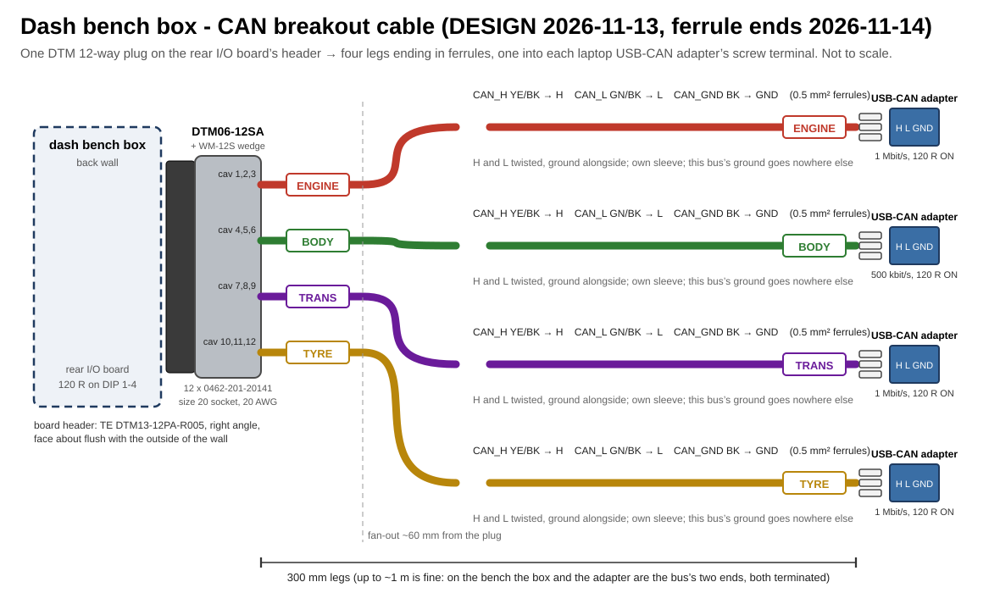

# CAN breakout cable

The cable that takes all four CAN buses out of the box's one 12-way connector and splits them into four separate bus
connections, one per bus, each ending in bare wires with ferrules that screw into a USB-CAN adapter.

## What it has to do

- Plug onto the rear I/O board's **TE DTM13-12PA-R005** right-angle header, whose face sits about flush with the
  outside of the back wall. 12 contacts = 4 buses x (CAN High, CAN Low, that bus's own ground).
- End in **one leg per bus**, so each bus goes its own way: on the bench, into its own USB-CAN adapter's screw
  terminal.
- Keep the four buses' grounds **apart from each other**. The PEAK card isolates each channel separately, and the
  board keeps each bus's ground as its own net. One shared drain wire in this cable would throw that away.
- Keep each leg **short**: it is a branch off a live bus (see "How long it may be").

## Parts

| Item | Part | Qty | Note |
|---|---|---|---|
| Box-end plug | TE DEUTSCH **DTM06-12SA** | 1 | 12-way plug, SOCKET contacts, keying **A**, grey, sealed (IP68), 3.81 mm centreline, 180° cable exit |
| Wedgelock | TE **WM-12S** | 1 | 12-position secondary lock, plug side. Every DTM connector needs one |
| Socket contacts | TE **0462-201-20141** | 12 | DTM size 20 socket, solid, nickel, indent crimp, 20 AWG, 7.5 A. The stamped-and-formed 1062-20-01xx family is interchangeable |
| Wire | 20 AWG TXL or similar stranded, 3 colours | ~5 m | |
| Leg ends | Insulated bootlace ferrules, 0.5 mm² (20 AWG), 8 mm pin | 12 | any make; they go straight into the adapters' screw terminals and do not fray |
| Sleeving | Expandable braid or adhesive-lined heat shrink | 4 | one sleeve per bus, from the fan-out to about 30 mm short of the ferrules |

TE's own page for the DTM06-12SA points at distributors rather than selling direct; the whole set is sold by the
usual electronics distributors and by motorsport wiring shops.

## Pinout

> **Check this before you crimp.** The order of the cavities in the board's header is taken from the connector's
> family convention, not from a numbered drawing: TE's drawings do not mark the cavities. Hold a plug against the
> board's header and read the moulded numbers on its wire side against the board's pin 1 before committing 12 crimps.

| DTM cavity | Bus | Signal | Wire | Adapter terminal |
|---|---|---|---|---|
| 1 | ENGINE | CAN_H | YE/BK, twisted with 2 | H |
| 2 | ENGINE | CAN_L | GN/BK, twisted with 1 | L |
| 3 | ENGINE | CAN_GND | BK | GND |
| 4 | BODY | CAN_H | YE/BK | H |
| 5 | BODY | CAN_L | GN/BK | L |
| 6 | BODY | CAN_GND | BK | GND |
| 7 | TRANS | CAN_H | YE/BK | H |
| 8 | TRANS | CAN_L | GN/BK | L |
| 9 | TRANS | CAN_GND | BK | GND |
| 10 | TYRE | CAN_H | YE/BK | H |
| 11 | TYRE | CAN_L | GN/BK | L |
| 12 | TYRE | CAN_GND | BK | GND |

- All four legs are wired the same: the buses are told apart by the **label and the sleeve**, not by wire colour.
- Each bus's ground goes **only** to its own adapter's ground. Nothing in the cable joins one bus to another, or to
  the box's 0 V.
- Nothing in the cable supplies power, and nothing in it terminates: the 120 Ω terminators are the box's DIP switch
  (lever 1-4 = ENGINE to TYRE) and each adapter's own switch. On the bench, both ends are usually on.

## How long it may be

A branch off a CAN trunk is a stub, and reflections off it are what limits its length; three of these four buses run
at 1 Mbit/s. Before this cable starts, the box has already spent about 200 mm of the PEAK card's patch cable and
~100 mm of board track.

- **Standard build: 300 mm legs** (plug face to ferrules), all four the same, fanning out about 60 mm from the plug.
- **Longer legs (up to ~1 m) only when the box is an END of that bus**, with its DIP lever on. Then the cable is not
  a stub at all: it is the last stretch of the trunk, and the 120 Ω at the end of it is the bus's own terminator.
  That is the normal bench case - adapter at one end, box at the other, nothing between.
- **Tapping the middle of a longer bus**: DIP off, keep the legs at 300 mm. If a bus shows errors, shorten the card's
  patch cable or make the box a bus end rather than lengthening this.

## Build

1. Cut 12 wires. Twist each bus's H and L together at about one turn per 25 mm; lay that bus's ground alongside the
   pair, not inside the twist.
2. Crimp a 0462-201-20141 socket on the box end of each wire (indent crimp, size 20 die). Pull-test every crimp.
3. Push the sockets home in the DTM06-12SA to the cavity numbers above; each gives an audible click and will not pull
   back out by hand.
4. Fit the WM-12S wedgelock. It only goes in one way round, and it will not seat if a contact is short of home: if it
   resists, find the contact rather than forcing it.
5. Sleeve each bus's trio from the fan-out to about 30 mm short of the ends, and shrink a label on at both ends.
6. Strip each wire 8 mm, crimp an insulated 0.5 mm² ferrule on it, and mark H / L / GND on the ferrules.
7. Check before it goes on a bus: continuity from cavity to ferrule for all 12, and **no continuity between any two
   buses** - every pair of the four grounds, and H and L across buses.

## The adapters on the other end

One single-channel USB-CAN adapter per bus, each with its own 120 Ω switch. The buses run at different speeds, so one
adapter per bus is simpler than a multi-channel box, and the open-source candleLight boards need no driver on Linux
(`gs_usb` / SocketCAN) and work with python-can.

Buy **one** first and prove your tooling with it: ENGINE and BODY cover almost everything a dash does, and TRANS and
TYRE can come later.

## In a car

There is no breakout cable in a car. The modules a dash computer listens to sit within reach of each other behind the
dash, so the vehicle harness ends its CAN branch in the **same DTM06-12SA**: twelve wires in one sleeve, and the four
buses separate inside the loom. One connector instead of five.
